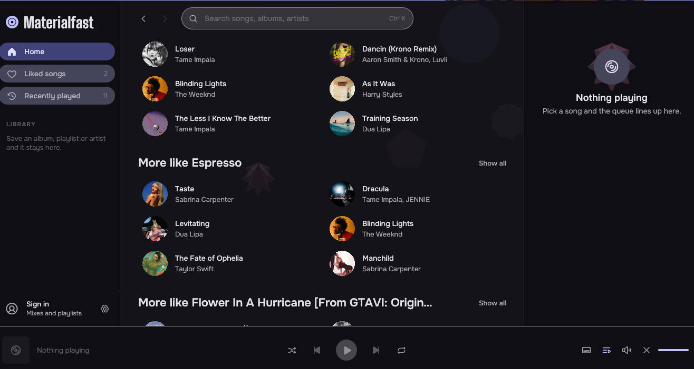

<p align="center">
  
</p>

<h1 align="center">Materialfast</h1>

<p align="center"><strong>YouTube Music, native and fast.</strong><br>A native desktop player for Windows, macOS and Linux, built with Rust and egui. No browser engine inside.</p>

<p align="center">
  <a href="https://github.com/yigitbozyaka/tubefast/releases/latest"><strong>Download</strong></a> ·
  <a href="#what-you-get">Features</a> ·
  <a href="#build-from-source">Build from source</a> ·
  <a href="CONTRIBUTING.md">Contribute</a>
</p>

<p align="center">
  <a href="https://github.com/yigitbozyaka/tubefast/actions/workflows/ci.yml"></a>
  <a href="https://github.com/yigitbozyaka/tubefast/releases/latest"></a>
  <a href="LICENSE"></a>
</p>



Materialfast is a native YouTube Music desktop player built with Rust and [egui](https://github.com/emilk/egui). It uses [eframe](https://github.com/emilk/egui/tree/master/crates/eframe) and glow to draw its own interface, talks to YouTube Music directly and decodes audio locally. There is no Chromium or WebView embedded in the app.

The app name is Materialfast. The public repository, Rust package, storage ID and compiled executable still use the historical `tubefast` name, so links, commands and download filenames below intentionally keep it.


## What you get

| | |
|---|---|
| **Search and browse** | Results appear as you type. Artist, album and playlist pages, with back and forward history. On an artist page, **Show all** loads the full list of top songs, albums, singles and EPs. |
| **A queue that keeps going** | Play an album or a single song. When the queue runs out, a radio based on the last track continues it. Shuffle and repeat are included, and **Stop** clears the current song while keeping the queue ready to play again. |
| **A queue you cannot lose** | Close the app and the queue, the track and the position are still there next time. Replace a queue you built by accident and **Undo** brings it back. Drag a row to reorder what plays next. |
| **Now playing and lyrics** | Click the cover or the title in the bar for a full-window view of the track. Its lyrics tab follows the song line by line when YouTube Music has timed lyrics, looks for them on [lrclib.net](https://lrclib.net) when it does not, and shows plain text when neither has them. Korean and Russian lyrics can show an approximate romanized line under each line, with a switch in the lyrics panel. |
| **Material You dynamic theming** | The interface follows a Material You-style palette. When a wallpaper-derived scheme is available, it uses that as the base; while a song is loaded, accents can follow the current cover without losing the wallpaper surfaces. Cover shape is changeable in Settings, and animations respect the system's Reduced Motion setting. |
| **Audio spectrum visualizer** | The full-screen player shows a 32-band spectrum that reacts to the playing track and fades in and out. Its position is configurable in Settings > Appearance: **Top** or **Bottom** relative to the queue. It calms down with Reduced Motion and does not keep repainting while the window cannot render. |
| **Updates itself** | When a new version is out, Materialfast tells you and installs it with one click, then restarts with your queue where it was. It works on Windows, for the AppImage and for a writable Linux binary folder, and for the macOS app bundle in a folder you can write to. Installs from a package manager or a read-only folder show the download page instead. |
| **Media keys** | Play, pause, next and previous keys work from any window, and the track shows up in the Windows media overlay, in Now Playing on macOS and in the Linux desktop's media controls (MPRIS), with its cover and progress. |
| **Global hotkeys** | Turn on **Global hotkeys** in Settings and play, pause, skip, change Materialfast's volume and open the media overlay while a game or another app has focus. Every shortcut can be changed or cleared, and a shortcut another app already holds is marked. They go straight to Materialfast, so other media players do not get in the way. Off until you turn it on. On Linux they work on X11 and on Wayland through the desktop's global shortcuts portal, where the keys are chosen in system settings; Settings says so if the portal is missing. |
| **Media overlay** | With **Global hotkeys** turned on in Settings, press `Ctrl` + `Alt` + `O` (changeable there) to open an always-on-top overlay with the current song, playback controls and the next songs in the queue. It does not take focus from your game. Opacity, position, playback controls and next up can each be changed or hidden in Settings. It works over windowed and borderless games, not exclusive fullscreen. On Linux it works on X11 and on Wayland desktops that support the layer shell protocol, such as KDE Plasma, Hyprland and sway. GNOME does not support it, so Settings says it is not available there. |
| **Minimize to tray** | Turn on **Minimize to tray on close** under Settings > Window and closing the window sends Materialfast to the tray. Music keeps playing and global hotkeys keep working. Left-click the tray icon to bring it back, right-click for Show and Quit. On Linux the tray needs a StatusNotifierItem host, which KDE Plasma has built in; GNOME needs the AppIndicator extension. |
| **Discord status** | Turn on **Show on Discord** in Settings and your Discord profile shows the song you are listening to, with its artist, cover and progress. The same section picks what the short status next to your name says: Materialfast, the artist, the song or a text of your own. It is off until you turn it on. |
| **A home feed that knows you** | Signed out, the feed is built from what you played here. Signed in, you get your own YouTube Music feed and playlists. |
| **Your library, kept locally** | Liked songs, listening history and saved albums, playlists and artists live on your computer. |
| **Real covers, clean titles** | Music videos show the album cover of the song instead of a video frame whenever YouTube knows which song it is. Titles drop "(Official Audio)", "[Lyrics]" and the like, and a featured artist moves to the artist line. |
| **Share** | The share button copies a music.youtube.com link to the song, album, playlist or artist, from the player bar, a page's banner or a track's menu. |
| **Keyboard first** | Shortcuts for everything that matters, plus accessible names on every control for screen readers. |
| **Profiles** | Run separate libraries and accounts side by side with `--profile`. |

## Supported platforms

| Platform | Release builds | Notes |
|---|---|---|
| Windows | x86-64 | A zip with `tubefast.exe`, plus a Scoop manifest. |
| macOS | universal (Apple silicon and Intel) | macOS 11 or later. The bundle is ad-hoc signed but not notarized. |
| Linux | x86-64 | AppImage and tar.gz builds for distributions with glibc 2.35 or newer. Audio output uses ALSA-compatible devices. X11 and Wayland are supported; Wayland-specific portal and layer-shell features depend on the desktop. |

Source builds are checked in CI on Windows, macOS and Linux.

## Install

Downloads are published on the [releases page](https://github.com/yigitbozyaka/tubefast/releases/latest). Each release also lists SHA-256 checksums in `SHA256SUMS.txt`.

**With [Scoop](https://scoop.sh)** on Windows, which shows no Windows warning:

```sh
scoop install https://github.com/yigitbozyaka/tubefast/releases/latest/download/tubefast.json
```

**By hand on Windows:**

1. Download `tubefast-windows-x64.zip` from the [latest release](https://github.com/yigitbozyaka/tubefast/releases/latest).
2. Right-click the zip, choose **Properties**, tick **Unblock** and press **OK**.
3. Unzip it anywhere and run `tubefast.exe`.

Step 2 is there because Materialfast is not code signed. Windows trusts a new program only after enough people have run it, so without that step the first launch shows "Windows protected your PC". If you see it, choose **More info**, then **Run anyway**.

**On macOS:**

1. Download `tubefast-macos-universal.zip` from the [latest release](https://github.com/yigitbozyaka/tubefast/releases/latest) and unzip it.
2. Move `Tubefast.app` to **Applications**.
3. Materialfast is not notarized by Apple, so clear the download flag once before the first launch:

```sh
xattr -dr com.apple.quarantine /Applications/Tubefast.app
```

**On Linux:**

- **AppImage:** download `Tubefast-x86_64.AppImage` from the [latest release](https://github.com/yigitbozyaka/tubefast/releases/latest), make it executable and run it:

  ```sh
  chmod +x Tubefast-x86_64.AppImage
  ./Tubefast-x86_64.AppImage
  ```

- **Installed for your user, with a menu entry:** download `tubefast-linux-x64.tar.gz`, unpack it and run the installer. It puts the executable in `~/.local/bin` and adds it to your app menu. `./install.sh --uninstall` removes it again.

  ```sh
  tar -xzf tubefast-linux-x64.tar.gz
  tubefast/install.sh
  ```

You can check that a download was built from this repository by GitHub, not by anyone else:

```sh
gh attestation verify tubefast-windows-x64.zip --repo yigitbozyaka/tubefast
```

## Sign in

Everything except your personal feed and your playlists works without an account. To sign in, click **Sign in** at the bottom of the sidebar and pick one of two ways:

- **Continue in browser** opens a supported Chromium- or Firefox-based browser window. Sign in to Google there and the window closes by itself.
- **Paste your cookie** if the browser window is refused by Google. The dialog lists the three steps.

If your Google account has more than one channel, such as a brand channel, the account row at the bottom of the sidebar reads **Switch channel** and picks which one Materialfast uses. The choice is kept for next time.

Your session stays on your computer. It is protected with your Windows account on Windows, or stored in a file only your user can read on macOS and Linux, and is sent only to YouTube. Sign out removes it.

## Shortcuts

`Ctrl` means `Cmd` on macOS, and `Alt` means `Option`. These shortcuts apply when Materialfast has keyboard focus and no text field is using it.

| Key | Action |
|---|---|
| `Space` | Play or pause |
| `Ctrl` + `K` or `/` | Jump to search |
| `Ctrl` + `→` / `Ctrl` + `←` | Next / previous track |
| `Ctrl` + `Z` | Bring back the queue you just replaced |
| `Esc` | Close the now playing view while recording a shortcut or viewing the expanded player |
| Media keys | Play or pause, next, previous, from any window |
| `Alt` + `←` / `Alt` + `→` | Back / forward |
| `F5` or `Ctrl` + `R` | Reload the page |
| `Ctrl` + `Alt` + `O` | Show or hide the media overlay (needs Global hotkeys turned on in Settings, can be changed there) |

Right-click a track, or use the **⋯** button on a row, for play next, add to queue, like, go to artist and go to album.

## Command line

The executable is still named `tubefast` so that commands match the downloadable files:

```sh
tubefast "daft punk"                 # open with a search
tubefast --play "get lucky"          # search and play the first result
tubefast --profile work              # separate library, history and sign-in
tubefast --selftest                  # check search, streaming and decoding without opening a window
```

## Build from source

You need [Rust](https://rustup.rs) 1.90 or newer.

```sh
git clone https://github.com/yigitbozyaka/tubefast
cd tubefast
cargo run --release
```

Use `cargo run -- --profile dev` for a separate library and sign-in while developing.

On Linux, install the ALSA development headers first (`sudo apt install libasound2-dev` on Debian and Ubuntu, or `sudo dnf install alsa-lib-devel` on Fedora). `linux/package.sh` turns a release build into the tar.gz used by releases, and into an AppImage too when `appimagetool` is installed.

On macOS, `cargo build --release && macos/bundle.sh` makes `target/Tubefast.app`, using the bundle name and icon shown by the system.

## How it works

- **Data** comes from the same internal API the YouTube Music website uses. Responses are parsed as they arrive, and fields the app never shows are skipped where possible.
- **Audio** is fetched progressively, decoded on its own thread with [Symphonia](https://github.com/pdeljanov/Symphonia) and `opus-decoder`, then handed to [rodio](https://github.com/RustAudio/rodio). Long tracks use a bounded sliding buffer instead of keeping the whole file in memory.
- **The interface** is immediate-mode egui on OpenGL. It avoids continuous repaints when idle, and background threads handle network and decoding work.
- **The visualizer** uses an FFT over the decoded samples to publish 32 frequency bands to the interface. The full-screen player draws those bands and offers a persisted Top or Bottom position in Settings.

## Contributing

Bug reports, fixes and features are welcome. See [CONTRIBUTING.md](CONTRIBUTING.md) for the workflow and repository layout. Before opening a pull request, run the same checks as CI:

```sh
cargo fmt --check
cargo clippy --all-targets -- -D warnings
cargo test
```

## Good to know

- **Materialfast is unofficial.** It is not affiliated with, endorsed by or sponsored by YouTube or Google. YouTube and YouTube Music are trademarks of Google LLC.
- **It can break.** YouTube changes its internal API without notice. The settings that usually need changing live in one small file, [`clients.json`](clients.json). When playback fails, Materialfast fetches the current copy from this repository and tries again, so most breakages can be fixed for everyone without a new download. `tubefast --selftest` tells you which step failed.
- **What it talks to.** YouTube, GitHub, and lrclib.net for lyrics. At start it reads `clients.json` and checks whether a newer release exists. A new version is downloaded only when you click **Update**, from this repository's releases, and is installed only if it matches the SHA-256 published with the release. Copies installed with Scoop are updated with `scoop update tubefast` instead. When you open the lyrics of a song that YouTube Music has no timed lyrics for, its title, its first artist and its length are sent to [lrclib.net](https://lrclib.net) to look for them there. With **Show on Discord** turned on, the title, artist, cover and position of the playing song are also handed to the Discord app on your computer. There is no telemetry.
- **If your Discord status does not show,** open the gear menu: the line under the switch says whether Materialfast found Discord. It needs the Discord desktop app, not Discord in a browser, running on the same computer, and a song that is playing rather than paused. If both are fine, look in Discord's own settings under **Activity Privacy**: sharing your activity with others has to be on there. How soon other people see a change is up to Discord.
- **If it crashes,** the reason is written to `crash.log` next to your data (`%APPDATA%\tubefast\data` on Windows, `~/Library/Application Support/tubefast` on macOS, `~/.local/share/tubefast` on Linux). Attach it to your bug report. These paths use the historical `tubefast` ID so existing saves keep loading.
- **Use it at your own risk.** YouTube's Terms of Service do not provide for third-party clients. Nobody can promise how YouTube treats accounts that use one. If that worries you, stay signed out.
- **Audio quality** is Opus at about 160 kbps (variable bitrate) when YouTube offers it, otherwise 128 kbps AAC.

## Acknowledgements

Materialfast exists because of **[Spotifast](https://github.com/crmne/spotifast)** by [@crmne](https://github.com/crmne). Spotifast showed that a streaming client can be a small native app instead of a browser in disguise. Materialfast takes the same idea and the same choices (Rust, egui, no browser engine) and applies them to YouTube Music. If you use Spotify, go and star it.

Built on [egui](https://github.com/emilk/egui), [Symphonia](https://github.com/pdeljanov/Symphonia), [rodio](https://github.com/RustAudio/rodio), `opus-decoder` and [ureq](https://github.com/algesten/ureq). Icons are [Phosphor](https://phosphoricons.com) (MIT). Typefaces are [Onest](https://fonts.google.com/specimen/Onest) and [Big Shoulders Display](https://fonts.google.com/specimen/Big+Shoulders+Display) (SIL Open Font License, texts in `assets/fonts`). Client parameters are kept in step with the research done by the [yt-dlp](https://github.com/yt-dlp/yt-dlp) project.

## License

[MIT](LICENSE)
